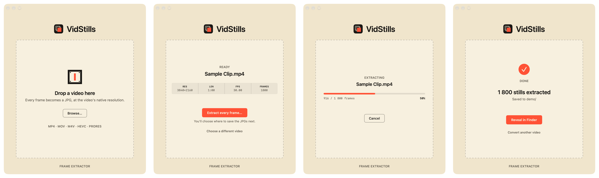

# VidStills

> Drag in a video. Choose a folder. Get every single frame as a full-resolution still.

VidStills is a tiny, free macOS utility that turns a video into a folder of images — one JPG for every frame, at the video's native resolution. There are no settings, no accounts, and nothing leaves your Mac.



*The whole app: drop a video → **Extract every frame…** → pick a folder → done.*

## Why I built it

AI tools are brilliant with images, but most of them can't properly *watch* a video. When you give one a clip, it usually grabs a handful of frames and guesses at the rest, so it misses things that happen between those samples.

I wanted the opposite: **every** frame, saved as an ordinary image, so I decide which moments an AI (or a designer, editor, or anyone else) gets to see. VidStills does exactly that one job. It is deliberately simple, and that's the point.

It's useful for:

- giving an AI model the exact stills you want it to analyse;
- pulling a perfect thumbnail or poster frame out of a clip;
- reviewing motion frame by frame (sport, animation, UI recordings, screen captures);
- building reference boards or storyboards from footage.

## How to use it

1. **Drop a video** onto the window, or click **Browse…**.
   MP4, MOV, M4V, HEVC and ProRes all work: anything macOS itself can play.
2. Check the details strip: resolution, length, frame rate and how many frames to expect.
3. Click **Extract every frame…** and **choose the folder** to save into.
   The stills go straight into that folder, with no extra subfolder. Use **New Folder** in the picker if you want one per video.
4. Watch the progress bar (you can **Cancel** at any time), then click **Reveal in Finder**.

Frames are named in order, padded so they sort correctly in Finder:

```
frame_0001.jpg
frame_0002.jpg
…
frame_1800.jpg
```

> **Heads-up on disk space:** a video has a *lot* of frames. One minute of 30 fps video is 1,800 images. As a guide, a 4K frame is roughly 0.5 MB and a 1080p frame roughly 0.25 MB. Test: a 60-second 4K clip produced 1,800 stills (about 0.9 GB) in under a minute on an Apple Silicon Mac.

## Install

### Option 1: download the app

Download **`VidStills.dmg`** from the [Releases](../../releases) page, open it, and drag **VidStills** into **Applications**.

The app is signed with a Developer ID and notarised by Apple, so it opens like any other Mac app, with no security warnings.

### Option 2: build it yourself (2 minutes)

You need a Mac with **Xcode 15 or later**. There are no third-party dependencies.

1. Clone or download this repository.
2. Open `VidStills.xcodeproj` in Xcode.
3. Choose the **VidStills** scheme and **My Mac**, then press **⌘R**.

From the command line:

```bash
xcodebuild -project VidStills.xcodeproj -scheme VidStills -configuration Release -derivedDataPath build build
```

The app is then at `build/Build/Products/Release/VidStills.app`.

The project signs "to run locally" by default, so you don't need an Apple Developer account to build and run it on your own Mac.

## Requirements

- macOS 14 Sonoma or later (Apple Silicon or Intel)
- Xcode 15+ to build from source

## Privacy

VidStills runs entirely on your Mac. It has no network code, analytics, telemetry or auto-update. It is sandboxed by macOS and can only read the video you give it and write to the folder you choose.

## How it works (short version)

VidStills reads the video from start to finish with Apple's `AVAssetReader`, the method Apple recommends for walking through every frame. It then saves each frame as a high-quality JPEG (quality 0.9) using Core Image and ImageIO. Portrait and rotated videos are turned the right way up automatically.

For the full technical write-up (architecture, why JPEG rather than PNG, and how to switch to lossless PNG), see **[docs/ARCHITECTURE.md](docs/ARCHITECTURE.md)**.

## Repository map

| Path | What it is |
|---|---|
| `VidStills/` | The SwiftUI app source |
| `VidStills.xcodeproj` | Xcode project (open this) |
| `docs/ARCHITECTURE.md` | How the app works internally, plus design tokens |
| `docs/images/` | Screenshots used in this README |
| `docs/branding/` | Source artwork for the app icon (light and dark) |

## Contributing and support

VidStills is intentionally small, and I'd like to keep it that way. Bug reports and focused improvements are very welcome. See [CONTRIBUTING.md](CONTRIBUTING.md), [SUPPORT.md](SUPPORT.md), [SECURITY.md](SECURITY.md) and [CODE_OF_CONDUCT.md](CODE_OF_CONDUCT.md).

## Licence

VidStills is free and open source under the [MIT License](LICENSE). Use it, change it, share it, or build it into something bigger.

---

<p align="center"><sub>Made by Neil de la Harpe · <a href="https://skilld.design/?utm_source=github&utm_medium=readme&utm_campaign=vidstills">Skilld Design</a></sub></p>
